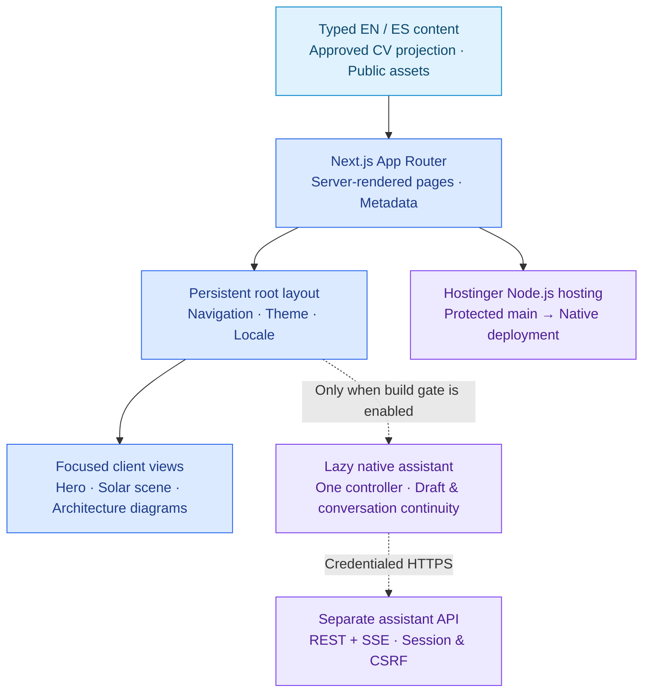
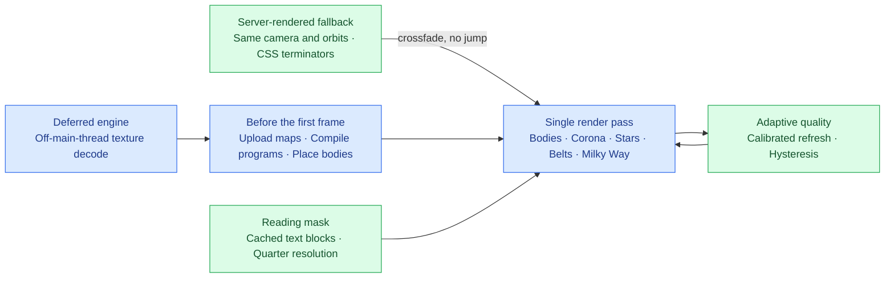
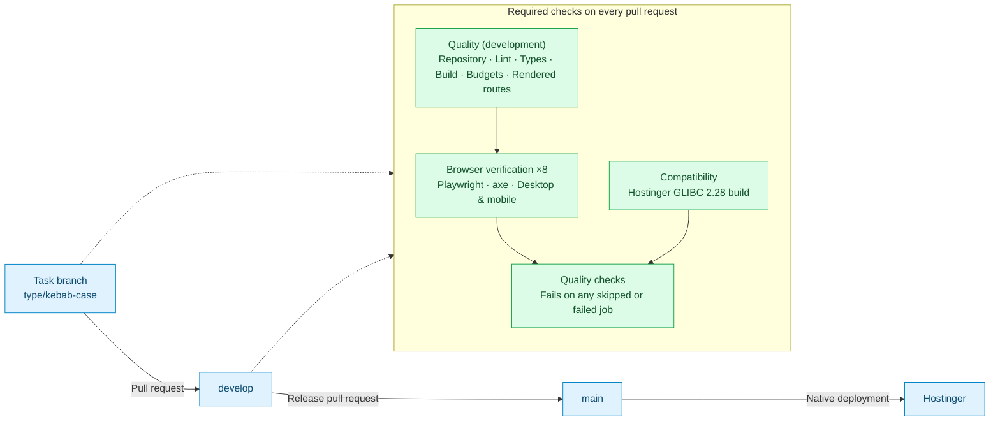

<div align="center">

<picture>
  <source media="(prefers-color-scheme: dark)" srcset="docs/gallery/home-hero-dark.webp">
  
</picture>

# Gonzalo Martin Perez · Portfolio

**Software Engineer · AI Engineer · Product Engineer**

A bilingual portfolio with production experience, interactive architecture diagrams,
reviewed CVs, a focused technology catalog and a realistic, readable 3D solar scene.

[](https://github.com/gonzalomartinperez/portfolio/actions/workflows/ci.yml)


**[gonzalomartinperez.com](https://gonzalomartinperez.com)** ·
[Gallery](#gallery) · [Architecture](docs/architecture.md) · [Design system](docs/design.md) ·
[Development workflow](docs/development.md) · [Technology decisions](docs/technology.md)

</div>

## Highlights

| | |
| --- | --- |
| **Production evidence** | Eight routes in English and Spanish: experience, the Filomena case study, education, a typed technology catalog and a self-contained CV with reviewed PDF downloads. |
| **Interactive architecture** | React Flow diagrams with keyboard-accessible detail panels explain the systems behind each role. |
| **Hero identity** | A lazy Three.js particle sphere and GSAP native-scroll choreography that settles into the technology toolkit. |
| **Solar scene** | A single-pass Three.js renderer with physically motivated shaders, a baked Milky Way and a reading mask that keeps text contrast on every page. |
| **Engineered quality** | Strict TypeScript, Biome, budgets, rendered checks and eight duration-balanced Playwright groups gate every pull request. |
| **Reviewed delivery** | Task branch → `develop` → `main` through protected pull requests; native Hostinger deployment from `main`. |

## Gallery

Captured from the production build at 2× density (desktop 1440 × 900 CSS px, Pixel 7 for
mobile) on a hardware GPU. The scene animates continuously; these are single frames.

<table>
  <tr>
    <td width="50%"><br><sub><b>Home · technology toolkit.</b> The hero sphere settles into a labeled grid; the scene recedes behind it.</sub></td>
    <td width="50%"><br><sub><b>Home · featured project.</b> Product screenshots, stack and production outcomes.</sub></td>
  </tr>
  <tr>
    <td><br><sub><b>Work · architecture.</b> Interactive diagrams with component details.</sub></td>
    <td><br><sub><b>Filomena · architecture.</b> The rebuilt exam platform, from browser to data.</sub></td>
  </tr>
  <tr>
    <td><br><sub><b>Filomena · application gallery.</b> 43 reviewed screens with workflow filters.</sub></td>
    <td><br><sub><b>About · light theme.</b> The scene becomes an ink-and-paper atlas.</sub></td>
  </tr>
  <tr>
    <td><br><sub><b>Stack.</b> Searchable catalog linked to the experience behind each entry.</sub></td>
    <td><br><sub><b>Education.</b> Curriculum with original names, dates and grades.</sub></td>
  </tr>
  <tr>
    <td><br><sub><b>Contact.</b> Direct channels and bilingual CV downloads.</sub></td>
    <td><br><sub><b>Español · light theme.</b> Every route mirrors under <code>/es</code>.</sub></td>
  </tr>
</table>

### Solar explorer

<table>
  <tr>
    <td width="33%"><br><sub><b>The full system.</b> Sun, nine orbits and the Moon.</sub></td>
    <td width="33%"><br><sub><b>Saturn.</b> Shadows cast both ways between planet and rings.</sub></td>
    <td width="33%"><br><sub><b>Earth.</b> Ocean glint, clouds, night lights and the Moon.</sub></td>
  </tr>
</table>

### Mobile

<table>
  <tr>
    <td width="25%"></td>
    <td width="25%"></td>
    <td width="25%"></td>
    <td width="25%"></td>
  </tr>
</table>

## Built with

**Application & interface**

      

**Motion, 3D & diagrams**

   

**Quality & delivery**

   

These badges describe this repository's implementation. The [professional technology catalog](https://gonzalomartinperez.com/stack) separately documents tools used across my work, with experience evidence. Badge artwork is served by Shields.io; technology names and marks belong to their respective owners and do not imply endorsement.

## Architecture at a glance



The portfolio has no application database or model-provider key. Reviewed content and documents are committed inputs; the optional assistant talks directly to a separately deployed API. [Explore the application, CV publication, and assistant boundaries](docs/architecture.md).

### Solar scene



Custom shaders give airless bodies Lommel–Seeliger photometry, gas giants limb darkening,
Earth its oceans, clouds and night lights, and Saturn's rings shadows in both directions.
Bright bodies recede behind reading text so it keeps WCAG contrast, enforced by a browser
test. Reduced motion, missing WebGL, texture failure and context loss keep the complete
static scene; hidden tabs suspend rendering. See the
[specification](docs/specs/immersive-solar-scene.md) and its
[verification record](docs/verification/immersive-solar-scene.md).

### Assistant availability

The native assistant is **disabled by default**. Unset or `false`
`ASSISTANT_ENABLED` removes the launcher and returns 404 for `/assistant` and
`/es/assistant`. Activation is not part of this delivery. For isolated development
or fixture verification only, run `ASSISTANT_ENABLED=true npm run dev` or
`ASSISTANT_ENABLED=true npm run build`. Static production output captures this
setting during the build; changing it on an existing build is not a rollout.
CI verifies the enabled conversation suite and a separate disabled Hostinger build.

## Delivery and quality



- **Deliberate scope:** no CMS, database, analytics, or speculative layers — static routes,
  typed content, and client boundaries only where interaction actually requires them.
- **Decisions written down:** the [design system](docs/design.md), specifications in
  [docs/specs](docs/specs/) and the [research note](docs/research/portfolio-2026-09-12.md)
  record what was chosen, what was rejected, and where the evidence is weak.
- **Traceable changes:** task branches integrate into `develop`; only `develop` can promote to `main`.
- **Verifiable quality:** [CI runs](https://github.com/gonzalomartinperez/portfolio/actions/workflows/ci.yml)
  expose lint, type-check, build, budget and browser results; flaky tests fail the gate.
- **Measured performance:** transfer budgets for scene JavaScript, styles, HTML and images,
  plus recorded frame-pacing and GPU-memory measurements with their conditions.
- **Structured AI collaboration:** six focused skills share one source of instructions,
  with clear ownership, review, and integration boundaries.

These are repository practices, not claims about completed client projects or application AI
features. Playwright and axe check production routes, both themes, keyboard journeys and failure
fallbacks. Automated tests complement visual review; they do not certify accessibility, security
or deployment success. Verification records in [docs/verification](docs/verification/) keep the
conditions and remaining limits of each release; the
[current release ledger](docs/specs/release-2026-10-03.md) reconciles combined requests.

## What the site contains

| Route | Contents |
| --- | --- |
| `/` | Positioning, the hero identity, portrait, selected evidence |
| `/about` | Professional narrative, how he works, languages, availability |
| `/work` | Experience and selected projects in one chronology |
| `/work/filomena` | The flagship product-engineering case study |
| `/stack` | Applied technology experience, AI-first categories and alphabetical entries |
| `/education` | Degree, academic results, and approved public evidence |
| `/contact` | Contact routes and what he is open to |
| `/cv` | Self-contained CV with reviewed PDF downloads |

English is served unprefixed and Spanish under `/es`, with the same path segments in
both, so switching language adds or removes the prefix and nothing else. Dark is the
default and needs no JavaScript; light is an explicit choice from the header toggle.
[The autonomy specification](docs/specs/portfolio-autonomy.md) holds the current scope
and acceptance criteria; the [redesign](docs/specs/portfolio-redesign.md) retains the
visual foundation. The [interaction specification](docs/specs/interactive-sphere.md)
covers sphere pulses, the keyboard-accessible avatar and restrained depth on interface controls.

## Engineering at a glance

| Area | Approach |
| --- | --- |
| Application | Next.js App Router, React, and Server Components by default |
| Type safety | TypeScript 7.0.2 with strict checking |
| Runtime | Node.js 24 LTS and Next.js 16 Active LTS |
| Interface | Owned shadcn/ui primitives, Tailwind utilities and CSS Modules; existing design tokens and focused client boundaries |
| Languages | American English and neutral Latin American Spanish, backed by a shared typed copy contract |
| Hero identity | Owner-selected caricature, lazy Three.js particle scene and GSAP native-scroll choreography |
| Solar scene | Single-pass Three.js with custom GLSL, reading mask, adaptive resolution and complete static fallbacks |
| Technology catalog | Shared typed inventory, original-color local marks and linked experience context |
| Code quality | Biome linting and formatting, locked dependency installation |
| Delivery | Protected pull requests, GitHub Actions CI, native Hostinger CD from `main` |
| AI-assisted development | Shared Claude Code and Codex guidance, specifications, isolated worktrees |

TypeScript 7 is stable, not LTS. Next.js still labels its default TypeScript CLI
integration experimental. The [technology guide](docs/technology.md) explains
the compatibility decision and fallback.

## Run locally

Use the Node.js version in [.nvmrc](.nvmrc) and its bundled npm 11.
The hosting compatibility baseline is Node 24.6.0 with npm 11.5.1; CI also tests
the newer local baseline. No Corepack setup or separate package-manager download
is required. See [technology decisions](docs/technology.md) for the version policy.

```sh
npm ci
npm run dev
```

Open `http://localhost:3000`. No database, credentials, or external services are required.
On Windows PowerShell, use `npm.cmd` if execution policy blocks `npm`.

<details>
<summary><b>All commands</b></summary>

| Command | Purpose |
| --- | --- |
| `npm run build` | Compile Next.js with Webpack for hosting compatibility; no Biome invocation |
| `npm run check` | Repository checks, formatting, lint, and one production build with type validation |
| `npm run typecheck` | Fast standalone type validation without a production build |
| `npm run test:repository` | Check UTF-8, local links, skill adapters, and compiler version alignment |
| `npm run test:smoke` | After `build`, check the production server responds correctly |
| `npm run test:browser` | After `build`, exercise desktop/mobile routes, axe and scene fallbacks |
| `npm run test:site` | Run rendered and browser verification with one production-server lifecycle |
| `npm run test:documents` | Verify approved local document signatures, sizes and hashes |
| `npm run test:identity` | Verify favicon and PNG outputs match the approved avatar source |
| `npm run identity:build` | Regenerate compatibility icons after an approved avatar change |
| `npm run format` | Apply formatting and safe Biome fixes |
| `npm run start` | Serve the previously built production app |

</details>

The [autonomy specification](docs/specs/portfolio-autonomy.md) covers the local CV,
academic evidence, prioritized technology catalogue and reversible scene. The
[public-content contract](docs/public-content.md) explains how approved exports are
updated without giving the public build access to private sources.

## Find your way around

<details open>
<summary><b>Source and documentation map</b></summary>

| Location | Contents |
| --- | --- |
| [src/app](src/app/) | Routes, layouts, metadata, and global styles |
| [src/components](src/components/) | Shell, identity mark, theme toggle, language switcher, hero and solar scene |
| [src/content](src/content/) | Typed per-locale content and the shared interface-copy contract |
| [Architecture](docs/architecture.md) | Application boundaries, reviewed CV publication, and the disabled assistant integration |
| [Design system](docs/design.md) | Direction, tokens for both themes, typography, motion, the hero field |
| [Solar scene spec](docs/specs/immersive-solar-scene.md) | Acceptance criteria, rendering decisions and measured verification |
| [Solar assets](docs/assets/solar-system.md) | Texture provenance, licenses and runtime sizes |
| [Initial release spec](docs/specs/portfolio-initial-release.md) | Scope, acceptance criteria, and decisions |
| [Research note](docs/research/portfolio-2026-09-12.md) | Sources behind those decisions, including the weak ones |
| [Development guide](docs/development.md) | Code conventions, SDD, branches, agents, and review |
| [Code-quality standard](docs/code-quality.md) | Readable code, necessary comments, useful API documentation |
| [Editorial guidelines](docs/editorial-guidelines.md) | Natural bilingual copy, evidence-aware claims, technology and brand presentation |
| [Public-content contract](docs/public-content.md) | Approved data projection, generated CV and reviewed document releases |
| [Technology guide](docs/technology.md) | Version policy, compatibility, and maintenance |
| [CI efficiency](docs/research/ci-efficiency.md) | Measured timing, complete balanced coverage and package-cache strategy |
| [Deployment guide](docs/deployment.md) | Hostinger setup and the CI/CD boundary |
| [Native assistant guide](docs/native-assistant.md) | Lazy panel, imported API contract, session ownership and activation checks |
| [AGENTS.md](AGENTS.md) / [CLAUDE.md](CLAUDE.md) | Shared agent contract and Claude entrypoint |

</details>

Code, documentation, and commit messages are English; the published interface ships in
English and Spanish. Task branches follow `type/kebab-case-description` naming and are
deleted after integration; `main` and `develop` remain protected. See the development
guide before contributing.

## Rights

All rights reserved; no reuse license is granted. Dependencies retain their own
licenses; planet textures are credited on the site and in the
[solar asset record](docs/assets/solar-system.md). This GitHub repository is public;
`"private": true` in `package.json` only prevents accidental publication to npm.
