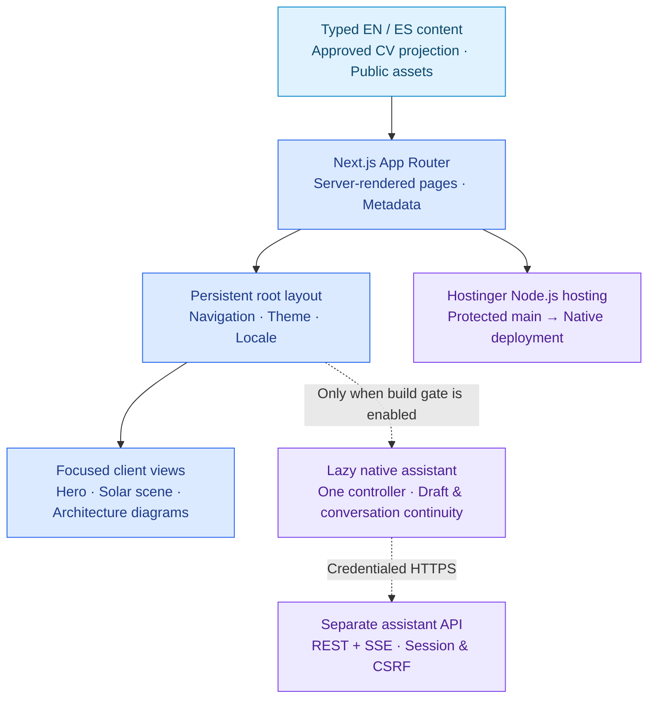

# Gonzalo Martin Perez · Portfolio

[](https://github.com/gonzalomartinperez/portfolio/actions/workflows/ci.yml)

A bilingual portfolio for **Software Engineer · AI Engineer · Product Engineer** work: production experience, interactive architecture diagrams, reviewed CVs, and a focused technology catalog. Eight core routes share two languages, two themes, and one persistent application shell.

**Live:** [gonzalomartinperez.com](https://gonzalomartinperez.com) — served from
Hostinger's managed Node.js hosting, with the domain registered through Cloudflare.
`main` is the branch connected to hosting; see the
[deployment guide](docs/deployment.md) for the CI/CD boundary.

[Explore the source](src/app/) · [Architecture](docs/architecture.md) · [Design system](docs/design.md) ·
[Technology decisions](docs/technology.md) · [Development workflow](docs/development.md)

## Built with

**Application & interface**

      

**Motion & diagrams**

  

**Quality & delivery**

  

These badges describe this repository's implementation. The [professional technology catalog](https://gonzalomartinperez.com/stack) separately documents tools used across my work, with experience evidence. Badge artwork is served by Shields.io; technology names and marks belong to their respective owners and do not imply endorsement.

## Architecture at a glance



The portfolio has no application database or model-provider key. Reviewed content and documents are committed inputs; the optional assistant talks directly to a separately deployed API. [Explore the application, CV publication, and assistant boundaries](docs/architecture.md).

### Assistant availability

The native assistant is **disabled by default**. Unset or `false`
`ASSISTANT_ENABLED` removes the launcher and returns 404 for `/assistant` and
`/es/assistant`. Activation is not part of this delivery. For isolated development
or fixture verification only, run `ASSISTANT_ENABLED=true npm run dev` or
`ASSISTANT_ENABLED=true npm run build`. Static production output captures this
setting during the build; changing it on an existing build is not a rollout.
CI verifies the enabled conversation suite and a separate disabled Hostinger build.

## What the site contains

| Route | Contents |
| --- | --- |
| `/` | Positioning, the hero identity, portrait, selected evidence |
| `/about` | Professional narrative, how he works, languages, availability |
| `/work` | Experience and selected projects in one chronology |
| `/work/filomena` | The flagship product-engineering case study |
| `/stack` | Applied technology experience, AI-first categories and alphabetical entries |
| `/education` | Degree, academic results, and approved public evidence |
| `/contact` | Contact routes and what he is open to |
| `/cv` | Self-contained CV with reviewed PDF downloads |

English is served unprefixed and Spanish under `/es`, with the same path segments in
both, so switching language adds or removes the prefix and nothing else. Dark is the
default and needs no JavaScript; light is an explicit choice from the header toggle.
[The autonomy specification](docs/specs/portfolio-autonomy.md) holds the current scope
and acceptance criteria; the [redesign](docs/specs/portfolio-redesign.md) retains the
visual foundation.
The [interaction specification](docs/specs/interactive-sphere.md) covers sphere
pulses, the keyboard-accessible avatar and restrained depth on interface controls.

## Engineering at a glance

| Area | Approach |
| --- | --- |
| Application | Next.js App Router, React, and Server Components by default |
| Type safety | TypeScript 7.0.2 with strict checking |
| Runtime | Node.js 24 LTS and Next.js 16 Active LTS |
| Interface | Owned shadcn/ui primitives, Tailwind utilities and CSS Modules; existing design tokens and focused client boundaries |
| Languages | American English and neutral Latin American Spanish, backed by a shared typed copy contract |
| Hero identity | Owner-selected caricature, lazy Three.js particle scene and GSAP native-scroll choreography |
| Technology catalog | Shared typed inventory, original-color local marks and linked experience context |
| Code quality | Biome linting and formatting, locked dependency installation |
| Delivery | Protected pull requests, GitHub Actions CI, native Hostinger CD from `main` |
| AI-assisted development | Shared Claude Code and Codex guidance, specifications, isolated worktrees |

TypeScript 7 is stable, not LTS. Next.js still labels its default TypeScript CLI
integration experimental. The [technology guide](docs/technology.md) explains
the compatibility decision and fallback.

## What this repository demonstrates

- **Deliberate scope:** no CMS, database, analytics, or speculative layers — static routes,
  typed content, and client boundaries only where interaction actually requires them.
- **Decisions written down:** the [design system](docs/design.md),
  [specification](docs/specs/portfolio-initial-release.md), and
  [research note](docs/research/portfolio-2026-09-12.md) record what was chosen,
  what was rejected, and where the evidence is weak.
- **Traceable changes:** task branches integrate into `develop`; only `develop` can promote to `main`.
- **Verifiable quality:** [CI runs](https://github.com/gonzalomartinperez/portfolio/actions/workflows/ci.yml)
  expose lint, type-check, and production-build results.
- **Structured AI collaboration:** six focused skills share one source of instructions,
  with clear ownership, review, and integration boundaries.

These are repository practices, not claims about completed client projects or application AI
features. Playwright and axe check production routes, both themes, keyboard journeys and failure
fallbacks. Automated tests complement visual review; they do not certify accessibility, security
or deployment success. The [initial verification log](docs/verification/portfolio-initial-release.md)
retains the historical baseline; the [redesign verification](docs/verification/portfolio-redesign.md)
records the visual foundation. The [autonomy verification](docs/verification/portfolio-autonomy.md)
records content migration, reversible scene measurements and remaining real-device limits.
The [production-profile update](docs/specs/professional-profile.md) records the latest
approved experience, catalogue and reviewed bilingual CV revision.
The [current release ledger](docs/specs/release-2026-10-03.md) reconciles the
combined requests, implementation boundaries and remaining verification.

## Run locally

Use the Node.js version in [.nvmrc](.nvmrc) and its bundled npm 11.
The hosting compatibility baseline is Node 24.6.0 with npm 11.5.1; CI also tests
the newer local baseline. No Corepack setup or separate package-manager download
is required. See [technology decisions](docs/technology.md) for the version policy.

```sh
npm ci
npm run dev
```

Open `http://localhost:3000`. No database, credentials, or external services are required.
On Windows PowerShell, use `npm.cmd` if execution policy blocks `npm`.

| Command | Purpose |
| --- | --- |
| `npm run build` | Compile Next.js with Webpack for hosting compatibility; no Biome invocation |
| `npm run check` | Repository checks, formatting, lint, and one production build with type validation |
| `npm run typecheck` | Fast standalone type validation without a production build |
| `npm run test:repository` | Check UTF-8, local links, skill adapters, and compiler version alignment |
| `npm run test:smoke` | After `build`, check the production server responds correctly |
| `npm run test:browser` | After `build`, exercise desktop/mobile routes, axe and scene fallbacks |
| `npm run test:site` | Run rendered and browser verification with one production-server lifecycle |
| `npm run test:documents` | Verify approved local document signatures, sizes and hashes |
| `npm run test:identity` | Verify favicon and PNG outputs match the approved avatar source |
| `npm run identity:build` | Regenerate compatibility icons after an approved avatar change |
| `npm run format` | Apply formatting and safe Biome fixes |
| `npm run start` | Serve the previously built production app |

The [autonomy specification](docs/specs/portfolio-autonomy.md) covers the local CV,
academic evidence, prioritized technology catalogue and reversible scene. The
[public-content contract](docs/public-content.md) explains how approved exports are
updated without giving the public build access to private sources.

## Find your way around

| Location | Contents |
| --- | --- |
| [src/app](src/app/) | Routes, layouts, metadata, and global styles |
| [src/components](src/components/) | Shell, identity mark, theme toggle, language switcher, hero |
| [src/content](src/content/) | Typed per-locale content and the shared interface-copy contract |
| [Architecture](docs/architecture.md) | Application boundaries, reviewed CV publication, and the disabled assistant integration |
| [Design system](docs/design.md) | Direction, tokens for both themes, typography, motion, the hero field |
| [Initial release spec](docs/specs/portfolio-initial-release.md) | Scope, acceptance criteria, and decisions |
| [Research note](docs/research/portfolio-2026-09-12.md) | Sources behind those decisions, including the weak ones |
| [Development guide](docs/development.md) | Code conventions, SDD, branches, agents, and review |
| [Code-quality standard](docs/code-quality.md) | Readable code, necessary comments, useful API documentation |
| [Editorial guidelines](docs/editorial-guidelines.md) | Natural bilingual copy, evidence-aware claims, technology and brand presentation |
| [Public-content contract](docs/public-content.md) | Approved data projection, generated CV and reviewed document releases |
| [Technology guide](docs/technology.md) | Version policy, compatibility, and maintenance |
| [Deployment guide](docs/deployment.md) | Hostinger setup and the CI/CD boundary |
| [AGENTS.md](AGENTS.md) / [CLAUDE.md](CLAUDE.md) | Shared agent contract and Claude entrypoint |

Code, documentation, and commit messages are English; the published interface ships in
English and Spanish. Task branches follow `type/kebab-case-description` naming and are
deleted after integration; `main` and `develop` remain protected. See the development
guide before contributing.

## Rights

All rights reserved; no reuse license is granted. Dependencies retain their own
licenses. This GitHub repository is public; `"private": true` in `package.json`
only prevents accidental publication to npm.

The [native assistant guide](docs/native-assistant.md) documents its stable lazy panel, imported API contract, session ownership, and activation checks.
