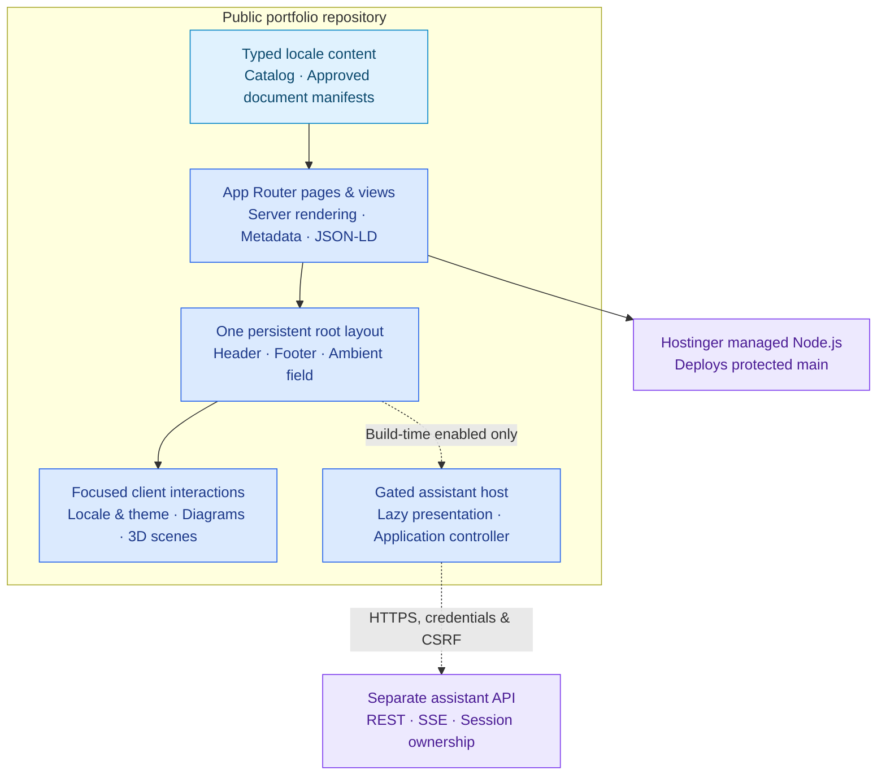
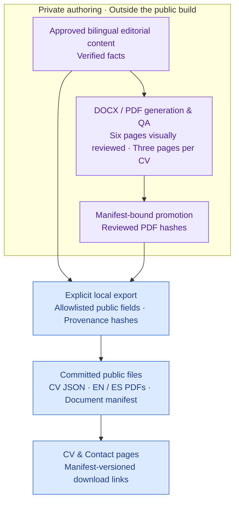
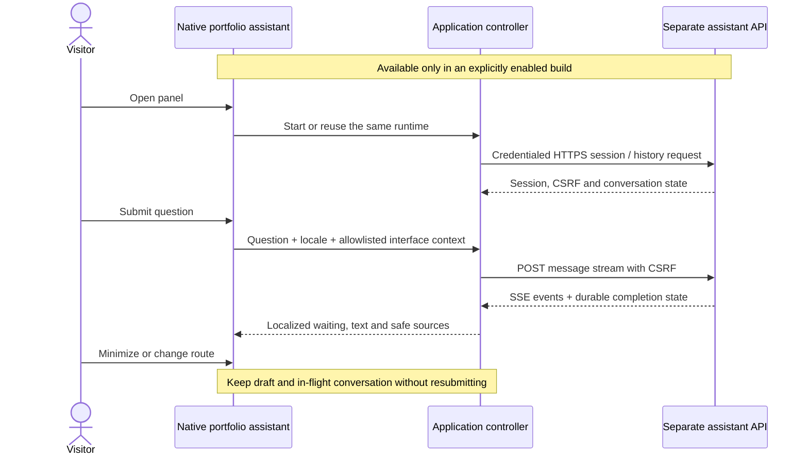

# Portfolio architecture

[Back to overview](../README.md) · [Design system](design.md) · [Native assistant](native-assistant.md)

The portfolio is a public presentation application with committed, reviewed content. It combines server-rendered pages with focused client interactions; it does not host a career database, an AI model, or the assistant backend. The eight core routes remain usable without an external service. The assistant is disabled by default and requires a separate deployment decision.

## Application boundaries

| Responsibility | Implementation and boundary |
| --- | --- |
| Routes and server rendering | [src/app](../src/app/) delegates page composition to [src/views](../src/views/). English uses unprefixed routes; Spanish uses `/es` with matching path segments. |
| Persistent shell | [Root layout](../src/app/layout.tsx) owns the header, footer, decorative background, and conditional assistant host. Locale changes share the same layout instead of creating a new application. |
| Reviewed public content | [src/content](../src/content/) stores typed bilingual copy, technology evidence, the generated CV projection, and approved document manifests. No private authoring inputs are read during a public build. |
| Interface system | Owned [UI primitives](../src/components/ui/), portfolio tokens, Tailwind utilities, and CSS Modules preserve consistent controls, responsive layouts, and both themes. |
| Interactive work diagrams | React Flow renders editorial architecture context. The diagrams represent approved experience, not repository runtime services or confidential employer infrastructure. |
| Decorative motion | Three.js provides the hero and solar scenes; GSAP coordinates the hero with native scrolling. Static fallbacks, reduced motion, visibility suspension, context recovery, and scoped motion holds remain separate from content. |
| Build and hosting | One locked npm installation and a type-checked Next.js build produce prerendered routes for managed Node.js hosting. Native Hostinger deployment follows `main`; repository CI does not configure the hosting account. |

### Motion and navigation

There are no visitor-facing pause buttons for the hero, page background, or immersive solar explorer. Motion still respects `prefers-reduced-motion`, stops in hidden documents, and recovers from WebGL context loss. The assistant can temporarily hold covered decorative motion through a scoped release mechanism. The technology carousel retains its own pause control and hover, focus, visibility, and touch behavior.

The static scene is a complete fallback, not an empty placeholder. Decorative canvases never replace headings, links, or the technology inventory. Theme and locale controls preserve the visitor's reading position. These behaviors have dedicated browser coverage; they do not establish a physical-device frame-rate guarantee.

## Reviewed CV publication

The private authoring workflow and the public site have different responsibilities. The public build receives only promoted documents and an approved projection.

[scripts/export-cv.mjs](../scripts/export-cv.mjs) requires explicit approved inputs, checks their revisions and promoted PDF provenance, and writes the public projection. [The document manifest](../src/content/public-documents.json) records approved file sizes and hashes. CI and browser tests verify the served files against these public inputs.

The exporter excludes private notes, evidence paths, phone numbers, vacancies, and hidden content. Generated CV JSON and promoted PDFs are not manually rewritten in this repository. Download URLs use the corresponding document hash as a cache key; live verification must inspect those actual links rather than an unversioned PDF URL. See the [public-content contract](public-content.md) for commands and release requirements.

## Native assistant integration

The assistant frontend is part of this application; its backend is not. The [assistant feature](../src/features/assistant/) separates domain models, an application controller, transport adapters, and presentation. [The root-layout host](../src/components/assistant/assistant-host.tsx) creates one lazy conversation runtime and preserves it across minimizing, resizing, locale changes, and internal navigation.

- The build-time `ASSISTANT_ENABLED` gate defaults to off. Disabled builds omit the launcher and return 404 for `/assistant` and `/es/assistant`. Changing a runtime environment value does not activate an already generated static build.
- The browser uses the API origin through credentialed HTTPS requests, with API-owned session cookies and CSRF protection. There is no Next.js assistant proxy or iframe implementation. Model-provider credentials remain outside the portfolio.
- [Imported contracts](../src/contracts/) define REST types and SSE schemas. Adapter validation handles unknown payloads; presentation does not render raw provider failures or unsafe HTML.
- The API owns conversations, generation, retrieval, persistence, and durable completion. Reconnection reads existing state; generation is not automatically repeated.
- Locale, theme, opened/current allowlisted paths, and presentation are optional interface context. Query strings, fragments, referrers, page HTML, and visitor attributes are excluded. These hints are untrusted and are not evidence about the professional profile.
- Local fixture tests validate frontend behavior with simulated responses. Production activation still requires the separately deployed API, exact-origin CORS, TLS/cookie/CSRF verification, and SSE proxy flushing and timeouts.

See [native-assistant.md](native-assistant.md) for bootstrap details, configuration, focus behavior, transport, and the production handoff. This document does not claim a deployed assistant API or authorize activation.

## Quality and integration

Task branches enter `develop` through protected pull requests; only `develop` promotes to `main`. The development job validates source, contracts, content, assets, lint, and a type-checked production build. Eight isolated browser shards consume the verified build. A separate Hostinger-compatible build validates the disabled assistant boundary. The required gate fails if required jobs fail, skip, or cancel.

[Development workflow](development.md) covers test commands and ownership. [Deployment](deployment.md) covers native hosting and public verification. [Code quality](code-quality.md) and [editorial guidelines](editorial-guidelines.md) define readable implementation and evidence-aware copy. Automated checks complement human and visual review; they are not blanket accessibility, security, or deployment certifications.
