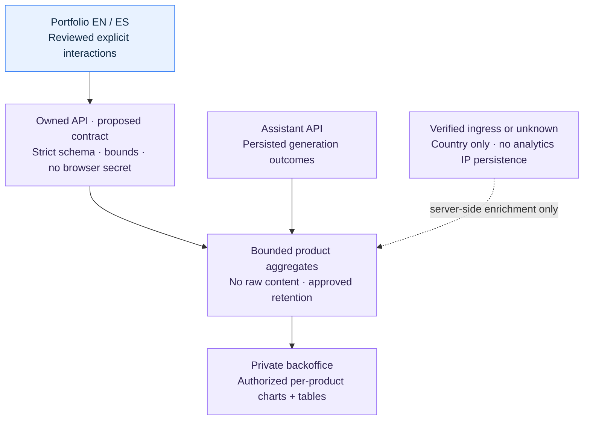

# Minimal product analytics and privacy notice

Status: draft

## Outcome and scope

Owner-requested design handoff, reviewed 2026-10-17. Give the maintainer useful,
coarse product-usage information in the private backoffice without introducing a
visitor-tracking identity or interrupting the public portfolio. This document is
not a shipped collector, accepted API schema, privacy-law determination or
activation approval. Existing assistant and analytics collection remain disabled.

The owner explicitly chooses **no accept-cookies banner on the portfolio**, with a
discreet, accurate footer/privacy notice. If a proposed measure requires consent,
omit or disable that measure rather than collecting silently or treating the footer
as consent. Pequeverso's separate owner controls its banner and implementation.

No advertising, session replay, fingerprinting, cross-site identifiers, raw prompts,
responses, direct personal identifiers or retained IP addresses in product analytics. No new
analytics SaaS, collector/container, queue, GeoIP database, paid call or provider key
is selected. Prefer a bounded extension of existing owned application capabilities.
Sites remain on managed Business hosting; VPS operations are separately owned.

## Acceptance criteria

| ID | Observable requirement | Current result |
| --- | --- | --- |
| AC-1 | Collection is off by default, independently of assistant rollout; off means no analytics requests, identifiers, cookies or storage writes | Planned; no collector implemented |
| AC-2 | Only reviewed event/section/locale combinations and bounded schema fields leave the browser; synthetic forbidden text/URL/cookie/token fields are rejected | Pending accepted API contract |
| AC-3 | Explicit link interactions are counted by their actual meaning; hydration, prefetch, theme changes, re-renders and bfcache do not create duplicate views | Pending implementation/tests |
| AC-4 | No credentials, referrer, session/conversation/run ID or persistent visitor ID accompanies an event; network rejection/offline cannot delay navigation or contact/CV links | Pending browser/network tests |
| AC-5 | Footer notice is bilingual, discreet and truthful to the enabled behavior; keyboard focus, contrast, zoom and mobile wrapping remain usable without a banner | Copy proposal below; not rendered |
| AC-6 | Country is trusted-edge-derived or unknown; spoofed client country is rejected and small aggregates are suppressed under an approved rule | Pending API/ops ownership decisions |
| AC-7 | Model counts come from persisted terminal run transitions, once per defined generation; retry, SSE reconnect/chunk and cancelled/failed outcomes are distinct | Pending API implementation; not existing ops counters |
| AC-8 | Private aggregate reads are authenticated and isolated by product; charts have labels, sample counts, UTC filters, table alternatives and distinct empty/unavailable states | Backoffice owner; pending |
| AC-9 | Existing JS/HTML/CSS budgets, reduced-motion behavior and keyboard flows remain satisfied; record comparable request/JS/render measurements, not an unmeasured speedup | Existing site baseline only; new feature untested |
| AC-10 | Source/history/build secret guards pass, all payload fixtures are synthetic and logs/artifacts exclude event content and credentials | Future increment must verify exact source |

## Design and decisions

### Observed baseline and ownership

The public site owns EN/ES presentation and the optional assistant client; the API
and backoffice owner owns ingestion, persistence, generation counters and aggregate
reads. Ops owns trusted ingress, resource/retention/recovery acceptance. This
handoff does not edit those repositories or invent an endpoint for their contracts.

Current source stores the user's theme preference in localStorage (`src/app/layout.tsx`
and `src/shell/theme-toggle.tsx`). This is separate from analytics identity; do not
reuse it to link events or describe the entire site as storage-free. The persistent
footer is `src/shell/site-footer.tsx`, already using the shared locale/chrome contract.
The assistant remains disabled under the existing deployment contract.

The coordinated ops draft is an attributed private operator handoff at
`vps-ops/docs/handoffs/analytics-and-dashboards.md`, source `55955bc`; it is not a
public-build dependency. The API owner's current operations counters are best-effort
observations, not audited visitor, generation or billing totals.

### Proposed vocabulary and envelope

Schema names are proposals to reconcile with the API owner, not generated contract
changes. One random event ID belongs to one event solely for deduplication; do not
add a redundant request ID or reuse it across navigation/assistant events.

| Field | Proposed boundary |
| --- | --- |
| schema_version | Explicit accepted version; no silent reinterpretation of ops telemetry |
| event_id | Random per-event ID, no browser persistence or visitor meaning |
| project / source | Fixed portfolio/site values at this composition point; strict backend enums |
| event_name | Reviewed enum below; reject source/event mismatches |
| section | home, about, work, filomena, stack, education, cv or contact |
| locale | en or es; not a country signal |
| target | Optional event-specific reviewed enum; never arbitrary labels, URLs or properties |
| received_at | Authoritative server UTC receipt time; not supplied by browser |
| occurred_at | Optional only if justified, bounded and untrusted; omit by default |
| country | Server-only trusted ISO country or unknown; never accept browser claims |

Candidate events: `page_view`, `navigation_click`, `section_open`, `cv_link_open`,
`contact_link_open`, and `company_link_open`. A CV click does not prove a completed
download, and a contact click does not prove a sent message. `section_open` means
an explicit expansion/action, not automatic visibility while scrolling.

Before implementing `page_view`, define initial document loads and actual client-side
navigation commits. Prefetch, component remounts, repeated effects, locale-independent
theme changes and bfcache restoration must not create additional views. Counts are
accepted events, never unique people; bots and dropped deliveries remain limitations.

### Browser and architecture boundary

If accepted, place a cohesive analytics feature under `src/features/`, with pure
vocabulary/validation in domain, a small application-owned transport port and a
browser fetch adapter. Shell/page composition owns deliberate named entrypoints.
Do not import assistant transport/session logic, introduce generic DI or add a
third-party tracking SDK. Keep public endpoint configuration independent of provider
keys and private backoffice credentials. Update the module guard deliberately if
new entrypoints are needed, with rejected-code fixtures.

The delivery adapter must explicitly omit credentials and referrer, avoid cache,
keep bodies bounded and fail without blocking the user's action. Prefer a fetch
configuration that can express these restrictions. `sendBeacon` does not expose
credential-mode controls and its processing model includes credentials; it is not
the default for this anonymous-ingestion boundary. No cookie-authenticated assistant
request helper, persistent queue, raw error logging or synchronous unload work.

No freeform dimensions, paths, query/hash, referrer, user-agent string, page text,
provider error bodies, conversation text or session/run identifiers. A public
browser cannot hold an ingest secret. CORS/Origin checks do not authenticate bots:
the API owner must define body/rate/storage bounds and abuse handling.

### Footer proposal and privacy gate

For an accepted, enabled minimal implementation:

- EN: “Privacy: aggregate usage metrics, without tracking cookies.”
- ES: “Privacidad: métricas de uso agregadas, sin cookies de seguimiento.”

A short accessible privacy explanation must describe the actual data, purposes,
operator/contact, retention and theme storage. Do not render a nonexistent privacy
link or claim active metrics before collection exists. Keep the footer reading order
and existing solar explorer intact; do not add another modal or focus trap simply
for this notice. Avoid low-contrast tiny text in either theme.

Cookieless is a technical configuration, not proof of anonymity or an exemption.
The no-banner choice constrains the implementation: any optional measure that needs
consent stays off. Review applicability and actual storage/network behavior before
activation; do not infer an exception from personal/showcase status.

### Country, counters and dashboards

Country-only edge enrichment is optional. Cloudflare documents `CF-IPCountry` on
all plans, but neither its presence nor a browser-supplied header proves a trusted
edge path. Ops must verify origin restrictions/header replacement before use.
No account toggle, city/coordinates transform or external lookup is requested here.
Without that verified boundary, use unknown. IP geolocation remains approximate.

Generation counts belong to persisted API transitions, not browser messages, SSE
chunks, retries or existing best-effort ops events. No raw run ID is exported into
analytics; internal transactional deduplication remains the API owner's concern.
Display outcomes/units and observation coverage accurately; estimates of tokens or
cost are not settled provider billing. Do not join website and assistant identities.

Retention, deduplication window, late events, small-cell suppression, quotas, indexing,
cleanup, backup expiry and restore behavior need accepted owner decisions. The ops
7-day dedupe / 30-day aggregate draft is explicitly unapproved, not a runtime default.
No migration or collector allocation is justified until these are resolved.

## Delivery plan

1. Reconcile this handoff with versioned API/backoffice and ops contracts. Resolve
   endpoint/schema/CORS, privacy applicability, retention and trusted country.
2. Implement bounded server ingestion/persisted counting and private aggregate reads
   under their respective owners, using synthetic fixtures and no paid model calls.
3. Add a default-off client slice and truthful EN/ES footer/privacy explanation;
   keep the assistant rollout independent and use the existing design system.
4. Verify keyboard/focus, readable light/dark contrast, zoom/mobile wrapping,
   network/storage absence while off and safe offline/429/5xx behavior. Measure
   bundle/request/render effects against the same tested baseline.
5. Run required source/history/build scans, architecture fixtures, full checks,
   unchanged native browser coverage and Hostinger compatibility on exact commits.
   Activation remains a separate readiness decision, not a docs or CI side effect.

## Verification and handoff

This increment reviews source boundaries and primary evidence only; no collector,
footer change, dashboard or performance claim is marked implemented. All feature
acceptance above remains pending until its owner supplies reproducible evidence.
Document/link checks apply to this handoff; they cannot establish runtime/privacy
acceptance. No real credentials, event content or provider calls are used.

Primary sources reviewed 2026-10-17:

- [Beacon specification](https://www.w3.org/TR/beacon/): delivery limitations and
  request processing; a draft specification, not a site compliance certificate.
- [Fetch Standard](https://fetch.spec.whatwg.org/#credentials): explicit credentials
  modes for the future transport adapter.
- [Cloudflare country information](https://developers.cloudflare.com/network/ip-geolocation/):
  country-only option, availability and accuracy limits; no account state verified.
- [CNIL analytics guidance](https://www.cnil.fr/fr/node/677): conditions matter for
  measurement exemptions; no automatic cross-jurisdiction conclusion is drawn.
- [WCAG 2.2](https://www.w3.org/TR/WCAG22/): accessible interaction criteria, without
  claiming automated checks alone establish conformance.
