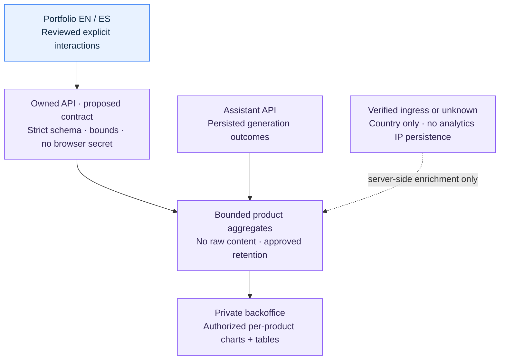

# Minimal product analytics and privacy notice

Status: in-progress

## Outcome and scope

Owner-requested implementation and design handoff, reviewed 2026-10-17. Give the maintainer useful,
coarse product-usage information in the private backoffice without introducing a
visitor-tracking identity or interrupting the public portfolio. The bounded client implementation follows the committed ingestion contract below.
This is not a privacy-law determination or activation approval. Production assistant
and analytics collection remain disabled; enabled tests use synthetic local sinks.

The owner explicitly chooses **no accept-cookies banner on the portfolio**, with a
discreet, accurate footer/privacy notice. If a proposed measure requires consent,
omit or disable that measure rather than collecting silently or treating the footer
as consent. Pequeverso's separate owner controls its banner and implementation.

No advertising, session replay, fingerprinting, cross-site identifiers, raw prompts,
responses, direct personal identifiers or retained IP addresses in product analytics. No new
analytics SaaS, collector/container, queue, GeoIP database, paid call or provider key
is selected. Prefer a bounded extension of existing owned application capabilities.
Sites remain on managed Business hosting; VPS operations are separately owned.

## Acceptance criteria

| ID | Observable requirement | Current result |
| --- | --- | --- |
| AC-1 | Collection is off by default, independently of assistant rollout; off means no analytics requests, identifiers, cookies or storage writes | Verified unit, disabled browser and smoke fixtures |
| AC-2 | Only reviewed event/section/locale combinations and bounded schema fields leave the browser; synthetic forbidden text/URL/cookie/token fields are rejected | Schema-bound negative tests and browser payload checks passed |
| AC-3 | Explicit link interactions are counted by their actual meaning; hydration, prefetch, theme changes, re-renders and bfcache do not create duplicate views | Unit deduplication and browser interaction fixtures passed; cache-admission limits below |
| AC-4 | No credentials, referrer, session/conversation/run ID or persistent visitor ID accompanies an event; network rejection/offline cannot delay navigation or contact/CV links | Header/cookie, 429/500/offline and navigation checks passed |
| AC-5 | Footer notice is bilingual, discreet and truthful to the enabled behavior; keyboard focus, contrast, zoom and mobile wrapping remain usable without a banner | EN/ES, both themes, real-key focus/200% text and scoped axe passed |
| AC-6 | Country is trusted-edge-derived or unknown; spoofed client country is rejected and small aggregates are suppressed under an approved rule | Pending API/ops ownership decisions |
| AC-7 | Model counts come from persisted terminal run transitions, once per defined generation; retry, SSE reconnect/chunk and cancelled/failed outcomes are distinct | Pending API implementation; not existing ops counters |
| AC-8 | Private aggregate reads are authenticated and isolated by product; charts have labels, sample counts, UTC filters, table alternatives and distinct empty/unavailable states | Backoffice owner; pending |
| AC-9 | Existing JS/HTML/CSS budgets, reduced-motion behavior and keyboard flows remain satisfied; record comparable request/JS/render measurements, not an unmeasured speedup | Unchanged budgets passed; comparable transfer measurements below |
| AC-10 | Source/history/build secret guards pass, all payload fixtures are synthetic and logs/artifacts exclude event content and credentials | Source/history plus sanitized enabled transfer passed; final CI belongs to PR |

## Design and decisions

### Observed baseline and ownership

The public site owns EN/ES presentation and the optional assistant client; the API
and backoffice owner owns ingestion, persistence, generation counters and aggregate
reads. Ops owns trusted ingress, resource/retention/recovery acceptance. This
handoff does not edit those repositories or invent an endpoint for their contracts.

Current source stores the user's theme preference in localStorage (`src/app/layout.tsx`
and `src/shell/theme-toggle.tsx`). This is separate from analytics identity; do not
reuse it to link events or describe the entire site as storage-free. The persistent
footer is `src/shell/site-footer.tsx`, already using the shared locale/chrome contract.
The assistant remains disabled under the existing deployment contract.

The coordinated ops draft is an attributed private operator handoff at
`vps-ops/docs/handoffs/analytics-and-dashboards.md`, source `55955bc`; it is not a
public-build dependency. The API owner's current operations counters are best-effort
observations, not audited visitor, generation or billing totals.

### Committed ingestion contract

The API owner committed the candidate contract at
`59a5ccec1b38bb1a3679497deffd02749c0e8d49`, with the public ingest route
`POST /api/v1/analytics/events`. The exact upstream JSON Schema is vendored at
[src/contracts/product-event.schema.json](../../src/contracts/product-event.schema.json),
SHA-256 `8203591a5b8768ffaa8bfa13399c50de1802be9075a8f78808e61c94aaa9f6ca`.
A unit check binds these bytes and separately verifies the event-specific semantic
restrictions documented by the upstream contract. API CI/promotion remains owned by
that session and is not established by importing its contract.

One random event ID belongs to one event solely for duplicate detection. The client
never persists it or reuses it across navigation/assistant events.

| Field | Proposed boundary |
| --- | --- |
| schema_version | Explicit accepted version; no silent reinterpretation of ops telemetry |
| event_id | Random per-event ID, no browser persistence or visitor meaning |
| project / source | Fixed portfolio/site values at this composition point; strict backend enums |
| event_name | Six reviewed names below; reject invalid section/target combinations |
| section | home, about, work, filomena, stack, education, cv or contact; navigation_click uses destination |
| locale | en or es; not a country signal |
| target | Optional event-specific reviewed enum; never arbitrary labels, URLs or properties |
| received_at | Authoritative server UTC receipt time; not supplied by browser |
| occurred_at | Forbidden in the browser payload |
| country | Forbidden in browser payload; current backend contract uses unknown only |

Accepted event names: `page_view`, `navigation_click`, `section_open`, `cv_link_open`,
`contact_link_open`, and `company_link_open`. A CV click does not prove a completed
download, and a contact click does not prove a sent message. `section_open` means
an explicit primary/keyboard opening of a work contribution disclosure, never a
visibility observation, closing action, programmatic expansion or middle-click.
`company_link_open` is limited to work and the three named employers;
`section_open` also accepts independent work. `cv_link_open` is limited to the CV
page and target en/es: PDF links on contact are intentionally outside this contract.
Contact targets are email/linkedin/github. Page/navigation events omit target.

`page_view` follows initial document loads and actual client-side
route commits through one controller retained per document. Prefetch, component remounts, repeated effects, locale-independent
theme changes and bfcache restoration must not create additional views. Counts are
accepted events, never unique people; bots and dropped deliveries remain limitations.

### Browser and architecture boundary

The analytics feature lives under `src/features/analytics/`, with pure
vocabulary/validation in domain, a small application-owned transport port and a
browser fetch adapter. Shell/page composition owns deliberate named entrypoints.
Do not import assistant transport/session logic, introduce generic DI or add a
third-party tracking SDK. Keep public endpoint configuration independent of provider
keys and private backoffice credentials. Update the module guard deliberately if
new entrypoints are needed, with rejected-code fixtures.

The delivery adapter must explicitly omit credentials and referrer, avoid cache,
keep bodies bounded and fail without blocking the user's action. Prefer a fetch
configuration that can express these restrictions. `sendBeacon` does not expose
credential-mode controls and its processing model includes credentials; it is not
the default for this anonymous-ingestion boundary. No cookie-authenticated assistant
request helper, persistent queue, raw error logging or synchronous unload work.

No freeform dimensions, paths, query/hash, referrer, user-agent string, page text,
provider error bodies, conversation text or session/run identifiers. A public
browser cannot hold an ingest secret. CORS/Origin checks do not authenticate bots:
the API owner must define body/rate/storage bounds and abuse handling.

### Footer disclosure and activation gate

The current-state note remains in both locales: no tracking cookies, with
the theme preference saved on the device. It adds no collector, privacy modal,
cookie banner, network request or storage behavior. An additional native disclosure describes actual feature flags, local preference
storage, external links/mail, hosting technical requests and the public contact.
It creates no consent action or identifier. There is no claim that aggregate
metrics are active in production.

The enabled synthetic fixture describes event names, coarse dimensions, reviewed
targets and per-event IDs without claiming persistent visitor identities. The brief
note can remain accurate because neither build uses tracking cookies. A later
activation still requires approved retention and processor/log facts; possible
metrics-specific short copy is:

- EN: “Privacy: aggregate usage metrics, without tracking cookies.”
- ES: “Privacidad: métricas de uso agregadas, sin cookies de seguimiento.”

A short accessible privacy explanation must describe the actual data, purposes,
operator/contact, retention and theme storage. Do not render a nonexistent privacy
link or claim active metrics before collection exists. Keep the footer reading order
and existing solar explorer intact; do not add another modal or focus trap simply
for this notice. Avoid low-contrast tiny text in either theme.

Cookieless is a technical configuration, not proof of anonymity or an exemption.
The no-banner choice constrains the implementation: any optional measure that needs
consent stays off. Review applicability and actual storage/network behavior before
activation; do not infer an exception from personal/showcase status.

### Country, counters and dashboards

The current committed ingestion contract fixes country to unknown. Future
country-only edge enrichment is optional and is not implemented by this client. Cloudflare documents `CF-IPCountry` on
all plans, but neither its presence nor a browser-supplied header proves a trusted
edge path. Ops must verify origin restrictions/header replacement before use.
No account toggle, city/coordinates transform or external lookup is requested here.
Without that verified boundary, use unknown. IP geolocation remains approximate.

Generation counts belong to persisted API transitions, not browser messages, SSE
chunks, retries or existing best-effort ops events. No raw run ID is exported into
analytics; internal transactional deduplication remains the API owner's concern.
Display outcomes/units and observation coverage accurately; estimates of tokens or
cost are not settled provider billing. Do not join website and assistant identities.

Retention, deduplication window, late events, small-cell suppression, quotas, indexing,
cleanup, backup expiry and restore behavior need accepted owner decisions. The ops
7-day dedupe / 30-day aggregate draft is explicitly unapproved, not a runtime default.
The later API candidate uses local test limits of 24-hour deduplication and seven
UTC days of aggregates in existing PostgreSQL; these supersede that earlier ops
proposal for local fixtures only. Production retention, backup expiry and rights
handling still require owner/ops decisions. This frontend does not run migrations
or allocate services.

## Delivery plan

### Authorized default-off client increment

The owner authorized implementation on 2026-10-17 through the coordinating ops
handoff. This does not authorize activation, hosted settings changes or consent-
dependent measurements. The API/backoffice owner first commits the exact ingestion
contract; the public client must reference that receipt before adding its transport.
The committed upstream receipt above supplies the executable integration contract;
the broader country/generation/activation proposals remain outside this slice.

The client lane owns an independent `ANALYTICS_ENABLED` build-time switch, default
off, and narrow analytics feature boundaries. Exact public route mapping rejects
unknown paths, query strings, fragments and assistant routes. An initial page view
and each committed route change are distinct from prefetch or rerender activity.
Only deliberately marked links/disclosures can produce interaction events; the
collector must not scrape labels, URLs, text or arbitrary DOM properties.

The same increment adds a native bilingual privacy disclosure without a banner or
modal. Its assistant and analytics availability text follows actual build flags.
It describes local theme storage, explicit external links and public email contact;
it does not invent hosting log retention, processor regions, a legal address or a
jurisdiction. The assistant's optional enabled fixture must describe a browser
session rather than promise anonymity and make API-provided retention discoverable
on mobile. Updated documentation records those unresolved activation prerequisites.

Verification must exercise both enabled synthetic fixtures and the disabled
production configuration. No enabled fixture contacts a live analytics/provider
service. Reuse existing CI builds/gates where possible; do not weaken test selection
or add a redundant full build merely for the new feature.

1. Reconcile this handoff with versioned API/backoffice and ops contracts. Resolve
   endpoint/schema/CORS, privacy applicability, retention and trusted country.
2. Implement bounded server ingestion/persisted counting and private aggregate reads
   under their respective owners, using synthetic fixtures and no paid model calls.
3. Add a default-off client slice and truthful EN/ES footer/privacy explanation;
   keep the assistant rollout independent and use the existing design system.
4. Verify keyboard/focus, readable light/dark contrast, zoom/mobile wrapping,
   network/storage absence while off and safe offline/429/5xx behavior. Measure
   bundle/request/render effects against the same tested baseline.
5. Run required source/history/build scans, architecture fixtures, full checks,
   unchanged native browser coverage and Hostinger compatibility on exact commits.
   Activation remains a separate readiness decision, not a docs or CI side effect.

## Verification and handoff

This increment implements the default-off public client and the EN/ES native
privacy explanation. API/backoffice validation and deployment are owned separately.
No production analytics activation, legal certification, unique-visitor accounting
or performance improvement is claimed. Analytics acceptance above remains pending
until its owner supplies reproducible evidence.
Document/link checks apply to this handoff; they cannot establish runtime/privacy
acceptance. No real credentials, event content or provider calls are used.

Primary sources reviewed 2026-10-17:

- [Beacon specification](https://www.w3.org/TR/beacon/): delivery limitations and
  request processing; a draft specification, not a site compliance certificate.
- [Fetch Standard](https://fetch.spec.whatwg.org/#credentials): explicit credentials
  modes for the future transport adapter.
- [Cloudflare country information](https://developers.cloudflare.com/network/ip-geolocation/):
  country-only option, availability and accuracy limits; no account state verified.
- [CNIL analytics guidance](https://www.cnil.fr/fr/node/677): conditions matter for
  measurement exemptions; no automatic cross-jurisdiction conclusion is drawn.
- [WCAG 2.2](https://www.w3.org/TR/WCAG22/): accessible interaction criteria, without
  claiming automated checks alone establish conformance.

### Earlier current-state footer verification (before this client increment)

The implemented notice was checked in Chromium at 1440×1000 and 390×844,
in English/Spanish and light/dark themes (eight combinations), using local HTTPS
and reduced motion. Footer-scoped axe checks reported zero violations, the notice
fit without horizontal overflow, and fresh controlled contexts contained no cookies,
no external requests and only the existing theme storage key. All eight screenshots
were visually inspected. This is bounded fixture evidence, not a WCAG certificate
or a verification of every production edge/storage behavior.

`npm run check` and 21 rendered route checks passed on the integrated candidate.
The local QA build enables the assistant fixture so its launcher is visible in
screenshots; this is not production activation, and external requests were blocked.
No collector, provider call or event storage was exercised. Screenshots and the
structured result live under ignored `.artifacts/privacy-review/`; the delivery PR
records final commit and protected CI receipts separately.

### Client implementation verification — 2026-10-17

The default-off public client is implemented against the immutable contract receipt
above. `npm run check` passed with 174 Node tests across architecture, analytics,
repository/models, assistant, content and budgets, plus lint, strict production
compilation, approved document/identity checks and the frozen assistant contract.
The runtime code was unchanged during subsequent focused test/document refinements.
All 22 rendered assertions passed on the enabled synthetic build. The browser
planner preserves all 440 pre-existing identities and includes 18 new ones: 458
identities across the existing eight groups, without new build jobs or weaker
retries, deadlines or budgets.

- Fourteen analytics unit tests cover closed dimensions, forbidden payload fields,
  exact schema bytes, route deduplication, endpoint restrictions, omitted credentials,
  referrer/cache policy, asynchronous errors, bounded concurrency and no retry queue.
- All 18 new EN/ES desktop/mobile browser cases passed. They exercise actual
  keyboard/click/download actions, per-event IDs, the absence of analytics cookies
  even when a synthetic response attempts `Set-Cookie`, pre-existing cookie omission,
  429/500/offline navigation, invalid targets and native disclosure semantics.
- Privacy keyboard coverage includes Enter/Space, Shift+Tab back to the summary,
  visible focus below the sticky header at 200% text, both themes and no horizontal
  overflow. Footer-scoped axe checks passed. The refined eight privacy cases passed
  separately after adding that explicit focus-obscuration check.
- A repeatable mixed-palette axe failure was retained in ignored QA artifacts.
  Assertions for actual body/link colors and a render frame before the scan resolved
  all three controlled repetitions, without changing colors or disabling a rule.
  Independent source review also found a middle-click falsely counted as a details
  opening; the corrected adapter and browser regression distinguish it from links.
- The independent disabled build passed budgets, smoke and both desktop/mobile
  rollout cases: no launcher, no assistant or analytics requests, no cookies/new
  identity storage, matching disabled notices and both assistant routes returning 404.
- The redacted guard passed 15 regression probes, the 653 tracked-file snapshot and
  all available full Git history. The sanitized enabled CI-transfer scan passed
  across 526 uploaded files; the normal runtime manifests were restored afterward.

Comparable Node gzip measurements use the preceding React 19.3.1 build with the
assistant fixture on and analytics off, versus the same toolchain with this client
fixture on. They measure transfer sizes, not physical-device rendering or a speedup:

| Measurement | Before | Candidate |
| --- | ---: | ---: |
| Non-assistant CSS | 24,521 bytes | 24,541 bytes (24 KiB budget unchanged) |
| Largest prerendered HTML | 62,250 bytes | 63,286 bytes (70 KiB budget unchanged) |
| Home initial script tags, distinct gzip files | 234,413 bytes | 237,374 bytes |
| Contact initial script tags, distinct gzip files | 225,853 bytes | 228,815 bytes |

The roughly 2.9 KiB initial-script increase covers the combined analytics/privacy
increment, not an isolated attribution to one module. These sums are build artifacts,
not proof every script is fetched simultaneously or a field Core Web Vitals result.
Eight theme/locale/viewport privacy captures were visually inspected; oversized
locator captures can include the existing sticky header. The separate real-key
assertion verifies the focused summary remains below that header.

Source audits found no need for a new dependency, action upgrade, parser, framework,
cache, build matrix or credential scope. Existing SHA-pinned Actions/read-only
permissions, same-run build sharing and full-history secret checking remain intact.
Three updated canonical skills passed their metadata validator and adapter/link
checks; they now route to the exact isolated QA commands and separate activation
from code integration. Public README, contributing, security, architecture, deployment
and assistant boundaries were reviewed for the actual behavior.

Not established by this evidence: physical-device screen-reader behavior, universal
WCAG conformance, production cross-origin/edge/provider privacy settings, approved
retention/backup expiry or a legal exemption. No provider call, live ingest, hosting
configuration change or activation took place. Final exact-head protected CI and
observed publication receipts belong to the delivery PR. API/backoffice acceptance,
coarse country handling and durable generation accounting remain their owners’ scope.

The combined local helper was also verified on the disabled candidate: 22 rendered
assertions followed by both rollout browser cases using separate owned HTTP/TLS
lifecycles and the same build. Final disabled browser cases additionally assert no
cookies, localStorage or sessionStorage entries in fresh contexts.
